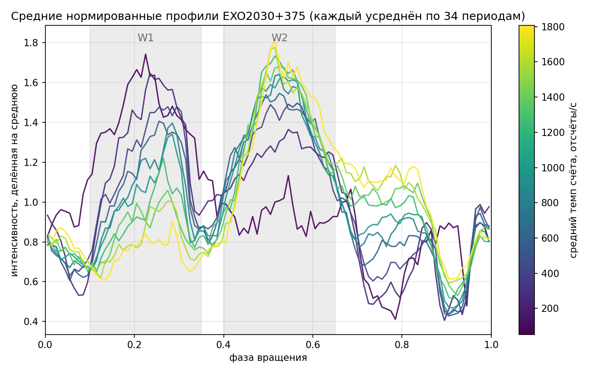
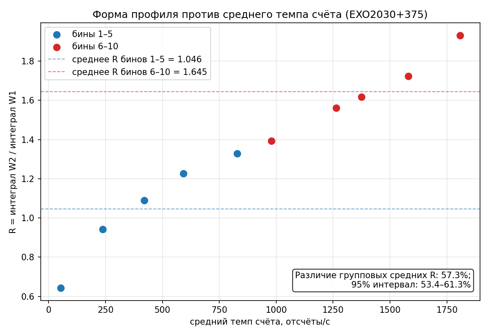

# ДЗ2 «Проверка»: форма профиля EXO2030+375 и яркость

[порождено: Codex при помощи промптинга со стороны пользователя] Текст оформлен по моей постановке задачи и указаниям, с моими редакторскими правками. Личные заметки ниже — мои исходные формулировки при выборе темы и данных.

| Поле | Значение |
|---|---|
| Направление | Вычислительное, направление B |
| Верификатор | Проверки свойств, договор о данных и синтетический контроль |
| Репозиторий | https://github.com/nansleeper0/ai4science |
| Метка версии для сдачи | `hw2` |
| Команда проверки из корня проекта | `python3 -m pytest checks/hw2 -q` |

## 1. Задача и место верификатора

[написано: личная заметка] «Давай лучше сделаем связь формы профиля пульса и светимости».

Для ДЗ2 я выбрал задачу из своего проекта EXO2030+375: проверить, как меняется соотношение двух участков среднего профиля при разной яркости. Я поставил эту задачу учебному агенту и выполнял работу поэтапно. Перед сравнением наблюдений нужно было проверить загрузку данных, нормировку и расчёт неопределённости.

Верификатор проверяет входные данные и вычисления на независимых примерах, затем на искусственных данных с известным ответом. Только после этого применяется расчёт к наблюдениям. Нулевой или неопределённый результат на реальных данных также считается допустимым исходом.

## 2. Методика

[написано: личная заметка] «10 бинов и самая длинная кривая в каждом».

Для эксперимента я задал выборку из десяти наблюдений — по одной самой длинной подготовленной кривой в каждом бине яркости. Диапазон исходного среднего темпа счёта разделён на десять равных по ширине бинов. Все кривые обрезаны до первых 34 полных периодов; в каждом периоде 100 фазовых отсчётов. Источник — подготовленные массивы исследовательского проекта EXO2030+375. Файлы, идентификаторы и контрольные суммы записаны в [manifest.csv](../data/profile_luminosity_10bins/manifest.csv) и [provenance.json](../data/profile_luminosity_10bins/provenance.json). Для воспроизведения расчёта достаточно приложенных NPZ, исходный FITS-архив не требуется.

Яркость в этой работе — средний темп счёта сохранённого участка, а не физическая светимость. Сначала усредняются 34 периода, затем профиль делится на свою среднюю интенсивность. Заранее выбраны окна W1=[0,10; 0,35) и W2=[0,40; 0,65). Показатель R — отношение интеграла профиля в W2 к интегралу в W1. Это отношение интегралов среднего профиля, а не среднее отношений отдельных периодов.

Основное сравнение: E = mean(R бинов 6–10) / mean(R бинов 1–5) − 1. Наблюдения имеют одинаковые веса. Неопределённость оценивается 2000 круговыми блочными bootstrap-повторами, seed=20261106. Внутри каждого наблюдения независимо выбираются 12 начал блоков по три периода, индексы замыкаются по модулю 34, остаются первые 34 строки. Дополнительный шум из ERROR не добавляется. При любом невалидном повторе сохраняются его номер и проблемные наблюдения, а общий интервал не вычисляется.

Практический порог δ=0,05 задан заранее. Если весь 95% интервал E выше +δ или ниже −δ, различие практически существенно; если весь интервал внутри [−δ; +δ], различие этой метрики практически мало; иначе результат неопределённый.

[Методика METHOD.md](../METHOD.md) зафиксирована до первых прогонов: 6 ноября 2026 года, исходный коммит `eb9d24a572d9a18443f51c19107db2be8dcd7cf1`. В отдельной чистой истории пакета тот же файл зафиксирован коммитом `39c32c1da6aff49a47f86685cd42d7cd61c9595d` от 6 ноября 2026 года, до результатов. SHA-256 файла: `01a57c695283488d8845c83eca4a6ba234b618dd33461bf818713c95e4353378`.

## 3. Верификатор

Для проверки я использовал тесты, подготовленные учебным агентом: 18 тестов ядра и загрузки, семь тестов синтетического эксперимента и 16 тестов реального расчёта и bootstrap. Итог — 41 пройденный тест. Количество тестов само по себе не служит доказательством: важны независимые контрольные примеры и обнаруженные нарушения.

| Свойство | Почему ожидается | Проверка |
|---|---|---|
| Площадь нормированного профиля равна 1 | Среднее по 100 равным фазовым бинам равно 1 | `test_normalized_area_is_one` |
| R не меняется при положительном масштабировании | Общий множитель сокращается в отношении | `test_R_scale_and_permutation_invariant` |
| R не меняется при перестановке периодов | Среднее не зависит от порядка строк | Тот же тест на различающихся периодах |
| Считается отношение интегралов среднего профиля | Усреднение отношений даёт другую величину | `test_R_is_ratio_of_integrals_not_mean_of_ratios`: 0,6 против ошибочного 0,75 |
| Отрицательные отсчёты не обрезаются | Договор допускает отрицательные RATE; clipping меняет результат | `test_negative_rate_inside_W2_no_clipping`: 0,94 против 0,96 |
| Изменённый NPZ со старой контрольной суммой отклоняется | Входы должны соответствовать зафиксированному набору | `test_manifest_sha_rejects_tampered` |
| Неопределённая метрика не превращается в число | Неположительные среднее или интегралы требуют явного отказа | Тесты неположительных среднего и интегралов |
| Известное изменение формы восстанавливается | У синтетики заранее известны E=0 и E=0,2 | Тесты без шума и 30 парных повторов |
| Bootstrap отдельно выбирает периоды каждого наблюдения | Наблюдения не должны искусственно пересэмплироваться совместно | `test_bootstrap_uses_independent_idx_per_observation` |

Проверка не подтверждает калибровку прибора, исходную свёртку по периоду и фазовую привязку. Эти операции выполнены раньше в исследовательском проекте.

## 4. Декомпозиция проверки

```text
Получить проверяемый вывод о различии R
├── Проверить входы: схема, контрольные суммы и метаданные
├── Проверить вычисление профиля, R и E на известных примерах
├── Восстановить нулевой и заданный эффекты на синтетике
└── Применить расчёт к наблюдениям и проверить bootstrap
```

Переход к следующему этапу разрешался после проверки предыдущего. Ниже перечислены сохранённые итерации, а не каждый отдельный вызов инструмента.

| Подцель | Итерация | Действие и результат |
|---|---|---|
| Входы и ядро | 1–3 | Goose: первоначальные 12 тестов; после независимого разбора — 17, затем 18 тестов с проверкой SHA-256 и метаданных |
| Синтетический контроль | 1 | Goose получил эффект около 0,10 вместо заданного 0,20; критерий не выполнен, вывод сохранён |
| Синтетический контроль | 2 | После разбора ошибки умножается весь профиль внутри W2; оба критерия выполнены |
| Реальный bootstrap | 1 | Независимый разбор обнаружил общие индексы периодов для всех наблюдений; интервал не принят |
| Реальный bootstrap | 2 | Goose исправил независимые выборки и сбор отказов; итог подтверждён отдельным расчётом |

Правило трёх попыток было записано заранее: после трёх неудач одной подцели требуется разбиение или смена подхода. Когда агент начал повторять рассуждения о нормировке, я остановил сессию и продолжил в новой сессии с уточнённым заданием и конкретным контрольным примером. Критерии, seed и ожидаемый эффект ради успешного результата не менялись.

## 5. Результаты прогона

Синтетика: 30 повторов, seed=0…29. Между базовой линией и контролем в каждом повторе используется один общий шумовой массив, независимый между наблюдениями. В контроле у наблюдений 6–10 значения профиля внутри W2 умножены на 1,2 с последующей общей нормировкой. Истинный эффект равен 0,2.

| Вариант | Среднее | Выборочное std | 95% t-интервал среднего |
|---|---:|---:|---|
| Базовая линия, E | −0,000347 | 0,005399 | [−0,002363; 0,001668] |
| Контроль, E | 0,199592 | 0,006378 | [0,197211; 0,201974] |
| Парная разность D | 0,199940 | 0,001023 | [0,199558; 0,200322] |

Оба заранее заданных условия выполнены: интервал базовой линии находится в [−0,05; 0,05], интервал D — в [0,15; 0,25]. Использован t-интервал с 29 степенями свободы. Для одного основного реального контраста поправка на множественные сравнения не вводилась.

На реальных наблюдениях средний R равен 1,0460 для бинов 1–5 и 1,6451 для бинов 6–10. E=0,572719: средний R второй группы выше на 57,27%. Все 2000 bootstrap-повторов валидны; процентильный 95% интервал E — [0,534133; 0,612781]. Он целиком выше δ=0,05: по выбранному правилу различие практически существенно. Это процент различия групповых средних R, а не процент изменения всего профиля.

Актуальные результаты находятся в `results/hw2/synthetic_corrected/` и `results/hw2/real_corrected/`. Старые `synthetic_failed_attempt/` и `real/` сохранены как неудачные попытки. Файлы `synthetic_runs.csv` и `synthetic_summary.json` непосредственно в `results/hw2/` тоже относятся к первоначальной неудачной попытке.





Независимая проверка подтвердила все 2000 сохранённых bootstrap-значений, границы интервала и соответствие профилей исходным матрицам. Продолжительность всей работы не измерялась. В чистом окружении проверка 41 теста заняла 1,67 с, синтетический расчёт — около 0,51 с, реальный — 2,49 с; это время запуска команд на данном компьютере, без установки зависимостей.

## 6. Пойманная ошибка

Первоначальный загрузчик принимал изменённый NPZ, хотя контрольная сумма в manifest оставалась старой. В контрольном примере два отсчёта изменены с компенсацией, сохраняющей средний RATE: проверка одного среднего подмену не обнаруживает.

| Ошибка | Происхождение | Чем обнаружена | До / после |
|---|---|---|---|
| Нет сверки SHA-256 | Реальная ошибка ранней реализации Goose | Один неизменный тест `test_manifest_sha_rejects_tampered` | [До: 1 failed](../results/hw2/caught_error_before.txt); [после: 1 passed](../results/hw2/caught_error_after.txt) |

Версия с ошибкой восстановлена позднее из сохранённой ранней копии, а не представлена как первоначальный коммит. В чистом пакете это ветка `hw2-bug-missing-sha`, коммит `d8b0049b004b480e920345ed7543a809eb17439e`. Происхождение и хеши описаны в [caught_error_provenance.json](../results/hw2/caught_error_provenance.json).

Дополнительно при разборе обнаружены неправильный синтетический генератор и совместные индексы реального bootstrap. Их исправления не сопровождались изменением зафиксированной методики.

## 7. Воспроизведение

Окружение: Python 3.10.12; NumPy 1.26.4, SciPy 1.15.3, Matplotlib 3.9.3, pytest 9.1.1. Версии закреплены в `requirements-hw2.txt`; pandas, GPU и сеть при самих расчётах не нужны.

8 ноября 2026 года пакет проверен в чистом локальном Git-клоне коммита `008c6a8` и новом виртуальном окружении с установкой закреплённых зависимостей. Получено 41 passed; повторные синтетические и реальные результаты совпали с сохранёнными JSON/CSV/NPZ. Подробности — [журнал проверки](../results/hw2/verification.txt) и [сводка воспроизведения](../results/hw2/reproduction_check.json). Для скачивания версии для сдачи используются репозиторий и метка `hw2`, указанные в командах ниже.

```bash
git clone https://github.com/nansleeper0/ai4science.git
cd ai4science
git checkout hw2
python3 -m venv .venv
.venv/bin/python -m pip install -r requirements-hw2.txt
.venv/bin/python -m pytest checks/hw2 -q
.venv/bin/python src/profile_synthetic.py --output-dir results/hw2/reproduced_synthetic
.venv/bin/python src/profile_real.py --out results/hw2/reproduced_real
.venv/bin/python src/plot_profile_results.py
```

Последняя команда рисует сохранённые актуальные результаты; два предыдущих расчёта используют отдельные выходные каталоги для сверки, сохраняя результаты исходного прогона.

Для воспроизведения пойманной ошибки в отдельной копии:

```bash
git checkout hw2-bug-missing-sha
.venv/bin/python -m pytest checks/hw2/test_profile_shape.py::test_manifest_sha_rejects_tampered -q
```

На отдельном чистом клоне ветки с ошибкой получено `1 failed`; на исправленном пакете — `1 passed`. Локальная воспроизводимость проверена. Редакция отчёта согласована автором работы 8 ноября 2026 года. Версия для сдачи обозначается меткой `hw2`.

В локальном комплекте материалов курса отсутствует `check_week6.py`, поэтому этот пункт самопроверки курса не запускался. Приведённые результаты относятся к собственному верификатору `python3 -m pytest checks/hw2 -q` и воспроизведению расчётов из чистого пакета.

## 8. Ограничения

В выборке только десять наблюдений — по одному из каждого бина яркости. Поэтому результат нельзя без дополнительной проверки переносить на весь архив. По 34 периода внутри наблюдения не являются 34 независимыми точками зависимости от яркости.

Bootstrap оценивает разброс при пересэмплировании периодов внутри уже выбранных наблюдений. Он условен на длине блока, фиксированных окнах и исходной фазовой привязке, не учитывает систематические ошибки калибровки и неопределённость отбора наблюдений. Проверка самой исследовательской подготовки не входит в этот верификатор.

Темп счёта не заменяет физическую светимость. R описывает соотношение двух окон: одинаковый R не означает одинаковый профиль, а рост R сам по себе не устанавливает физическую причину изменения. Работа показывает связь в выбранной выборке, не причинный закон.

## 9. Использование ИИ-ассистентов

Я выбрал научную задачу и объём выборки, запускал интерактивные сессии учебного агента и вносил редакторские правки в отчёт. Мои исходные формулировки отмечены как личные заметки в разделах 1 и 2. Для реализации и проверки использованы следующие инструменты:

| Часть работы | Пометка | Инструмент | Как проверено |
|---|---|---|---|
| Личные заметки о теме и выборе десяти кривых | `[написано]` | Пользователь | Сохранены исходные формулировки постановки задачи |
| `METHOD.md`, `src/profile_shape.py`, `src/profile_synthetic.py`, `src/profile_real.py`, `checks/hw2/`, `src/plot_profile_results.py` | `[порождено]` | Учебный агент AI4Science/Goose, DeepSeek, по моим заданиям | Контрольные примеры, 41 тест, сопоставление с сохранёнными результатами |
| Экспорт входной выборки (`src/prepare_profile_dataset.py`); помощь в уточнении методики и разборе ошибок; дополнительная техническая проверка; оформление отчёта и подписи рисунка | `[порождено: Codex при помощи промптинга со стороны пользователя]` | Codex | Контрольные суммы, отдельный пересчёт, проверка в чистом клоне, мои редакторские правки текста |

Пометки личных заметок относятся к моим формулировкам постановки задачи; происхождение программного кода и результатов проверки указано отдельно в таблице.
