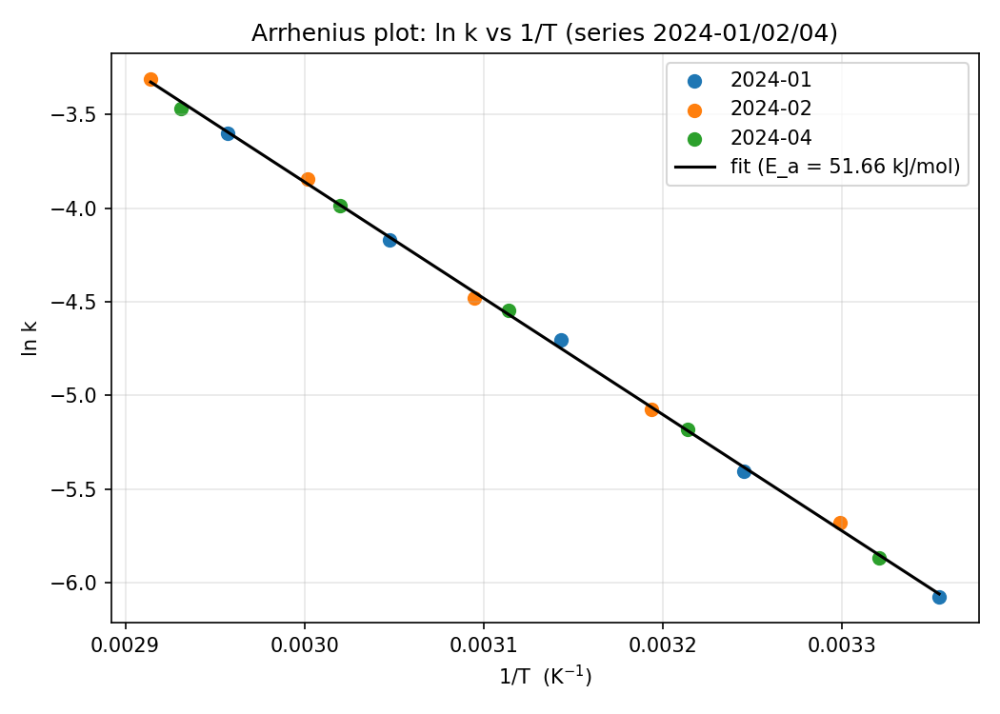

# Отчёт: согласованность данных с законом Аррениуса и оценка E_a

## Постановка

Проверялась согласованность скоростей реакции из `data/raw/rates.csv` с законом Аррениуса
в интервале 25–70 °C и оценивалась энергия активации. Закон Аррениуса связывает константу
скорости k с температурой T: ln k = ln A − E_a/(R·T), где R = 8.314 Дж/(моль·К)
[[Arrhenius 1889]]. В линейных координатах ln k от 1/T этому закону отвечает прямая линия
[[Laidler 1984]].

## Данные и метод

Использованы серии 2024-01, 2024-02 и 2024-04 (15 точек, 25–70 °C). Серия 2024-03
исключена из расчёта: она измерена с неисправным термостатом — при уставках ниже 50 °C
ячейка перегревалась примерно на 12 K, и температура в файле является уставкой, а не
фактической. Включение таких точек исказило бы оценку, поэтому они не использовались.

Метод — линейная регрессия ln k от 1/T (МНК), реализован в `src/fit.py`.

## Результат

По 15 точкам серий 2024-01, 2024-02, 2024-04:

- E_a = 51.66 кДж/моль (se 0.39 кДж/моль);
- ln A = 14.78;
- R² = 0.9993;
- max|resid| = 0.048.

Данные согласуются с законом Аррениуса. График использованных измерений в координатах
ln k от 1/T и линия подгонки — в `results/arrhenius_plot.png`.

## Независимая проверка

Результат проверен независимым способом — попарными двухточечными отношениями скоростей
внутри каждой серии (30 пар): E_a = 51.58 кДж/моль, что совпадает с основным расчётом
в пределах 0.1 кДж/моль. Реализовано в `src/verify.py`.

## Ограничения

- 30 попарных оценок используют общие точки, поэтому их разброс (std 2.35 кДж/моль) нельзя
  считать погрешностью итоговой оценки E_a. Значение 0.39 кДж/моль — стандартная ошибка
  оценки МНК при предположениях этой регрессии; возможные систематические ошибки
  измерений в неё не включены.
- Высокий R² (0.9993) показывает близость данных к прямой в этих координатах, но сам по
  себе не доказывает физический закон: хорошая линейная подгонка возможна и для данных,
  не следующих закону Аррениуса.

## Связи
- тип: [[Отчёт]]
- выполняет: [[Подготовить отчёт для коллег]]
- выполняет: [[Написать отчёт arrhenius.md]]
- описывает: [[Расчёт E_a по трём сериям]]
- описывает: [[Оценка E_a по трём сериям]]
- ссылаетсяНа: [[Arrhenius 1889]]
- ссылаетсяНа: [[Laidler 1984]]
